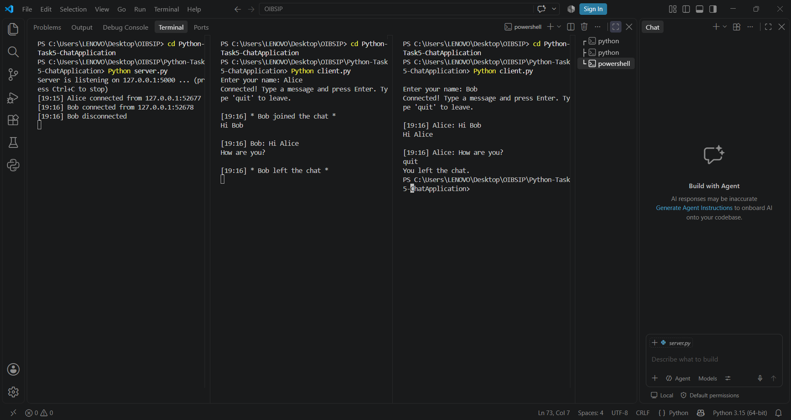

# Chat Application

A real-time command-line chat application built with Python sockets and threading. One server handles multiple clients, and messages are exchanged instantly between connected users.

## Features
- Server script that listens for incoming client connections
- Client script that connects to the server using a username
- Real-time, two-way message exchange between connected clients
- Timestamp prefix on every message, for example `[14:35] Alice: Hello`
- Join and leave notifications when a user connects or disconnects
- Runs on one machine using localhost (127.0.0.1)

## How to Run
1. Start the server first:
```
python server.py
```
2. Open a new terminal and start the first client:
```
python client.py
```
3. Open another terminal and start a second client, then enter different names and start chatting.
4. Type `quit` to leave the chat.

## Example Output


## Tech Used
- Python
- socket module
- threading module
- datetime module